<!--
  Each paper is one block: picture on the left, details on the right.
  Put pictures in assets/img/publications/ using the filename in each block.
  If a picture file is missing, it is simply hidden.
-->

CHARM: Training-Free Head-Adaptive Memory for Consistent Video Generation
<!-- link (hidden while under review): https://openreview.net/pdf?id=XB7emS6RJc -->
 Shweta Mahajan, Apratim Bhattacharyya, **Mariam Avagyan**
 Computer Vision and Pattern Recognition (CVPR) 2027. Under review.

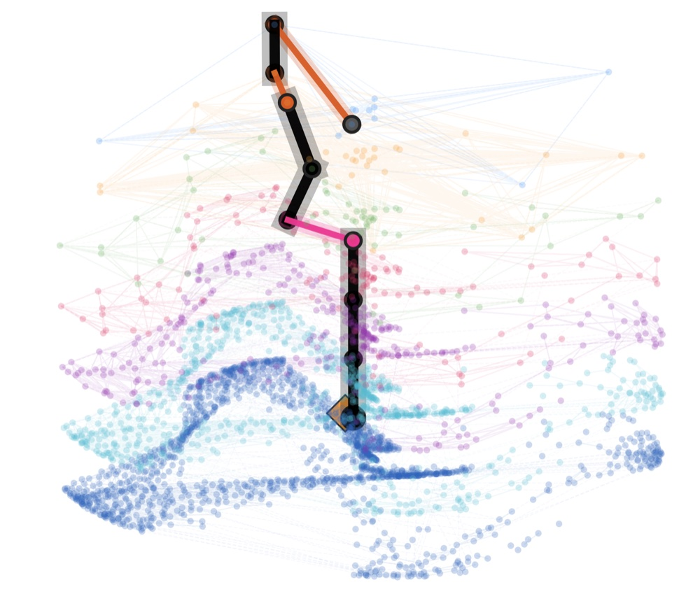

[Geometry-Aware Robust Denoising via Hierarchical Manifold Traversal](https://openreview.net/pdf?id=t26i2Tk32y)
 **Mariam Avagyan**, Shiyu Wang, Davit Shadunts, Szabolcs Marka, Zsuzsanna Marka, Shweta Mahajan, John Wright
 International Conference on Learning Representations (ICLR) 2027. Under review.

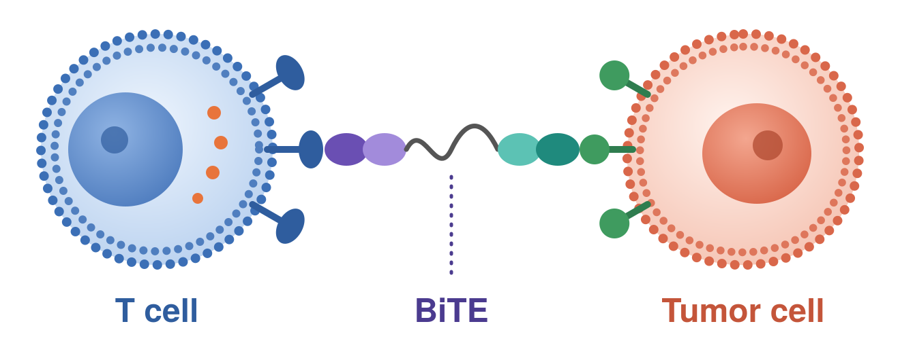

Dose-Window Formulation for Cytokine Release Syndrome Prediction with Transferable Representations.
 **Mariam Avagyan**, Maitreyee Bose, Guido Jajamovich, Khamir Mehta.
 CPT: Pharmacometrics and Systems Pharmacology (CPT:PSP). 2026. In Preparation.

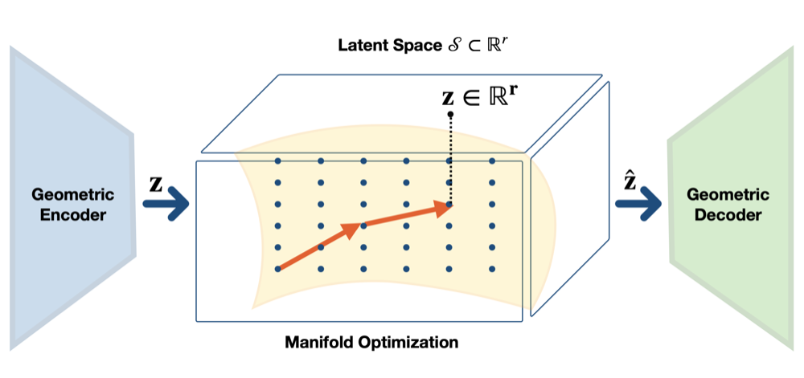

[Latent Express Traversal for Manifold Denoising](https://openreview.net/pdf?id=jR54770TuR)
 Shiyu Wang, **Mariam Avagyan**, Shreya Kadambi, Risheek Garrepalli, Fatih Porikli, Szabolcs Marka, Zsuzsanna Marka, Shweta Mahajan, John Wright.
 Conference on Neural Information Processing Systems (NeurIPS) Workshop on Bridging Optimal Transport, Learning and Structured Data: Toward Geometric Distributional Learning. 2026. Accepted.

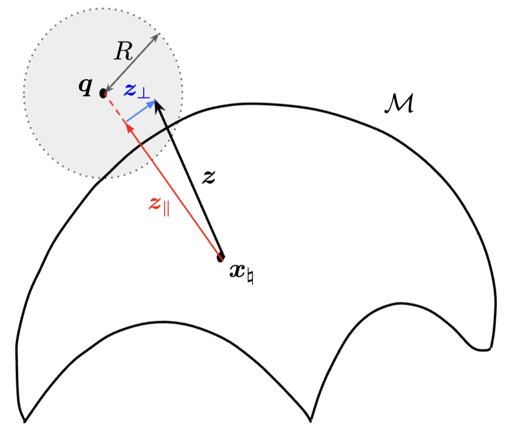

[Local Averaging Accurately Distills Manifold Structure From Noisy Data](https://arxiv.org/pdf/2506.18761)
 Yihan Shen, Shiyu Wang, Arnaud Lamy, **Mariam Avagyan**, John Wright
 arXiv preprint arXiv:2506.18761. June 2025.

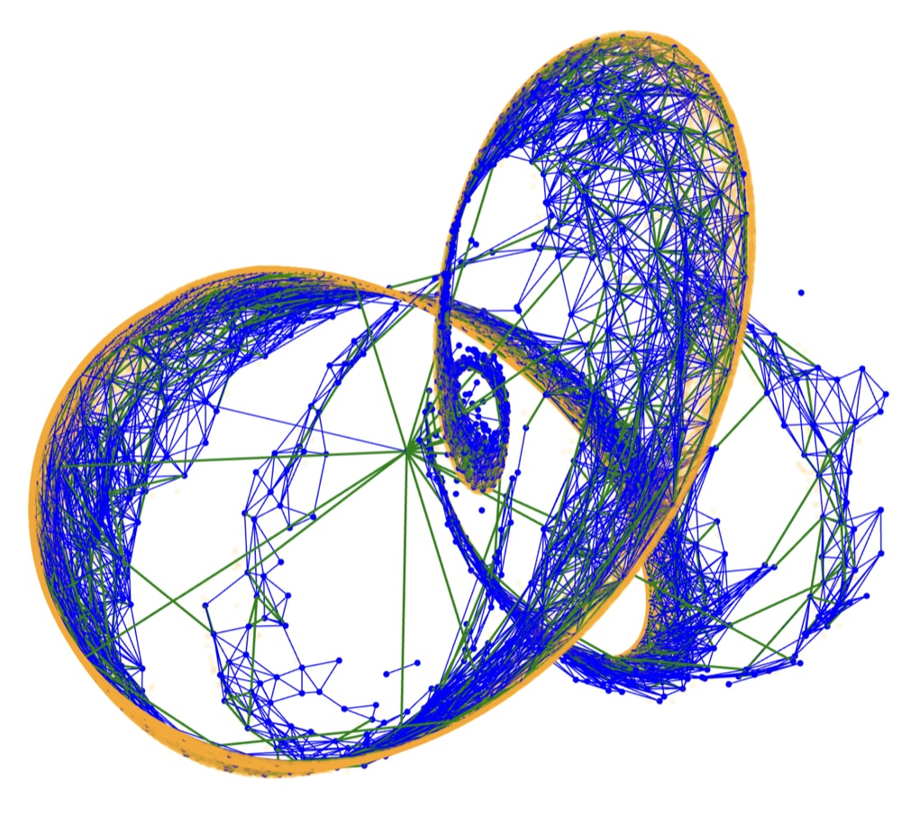

[Fast, Accurate Manifold Denoising by Tunneling Riemannian Optimization](https://openreview.net/pdf?id=jbafwTkVUn)
 Shiyu Wang, **Mariam Avagyan**, Yihan Shen, Arnaud Lamy, Tingran Wang, Szabolcs Marka, Zsuzsanna Marka, John Wright.
 International Conference on Machine Learning (ICML), PMLR 267:62297–62344. July 2025.

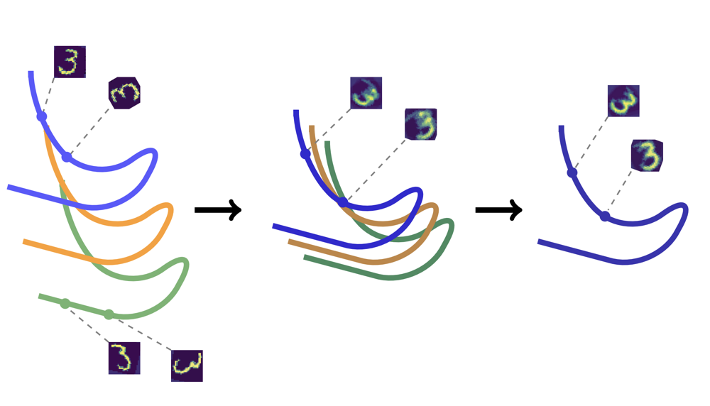

[Invariant Attention: Provable Clustering Under Transformations](https://openreview.net/pdf?id=SirD4KYNRr)
 Shree Rohith Pulipaka, **Mariam Avagyan**, Jackei Yang, John Wright
 OpenReview.net, 2024.

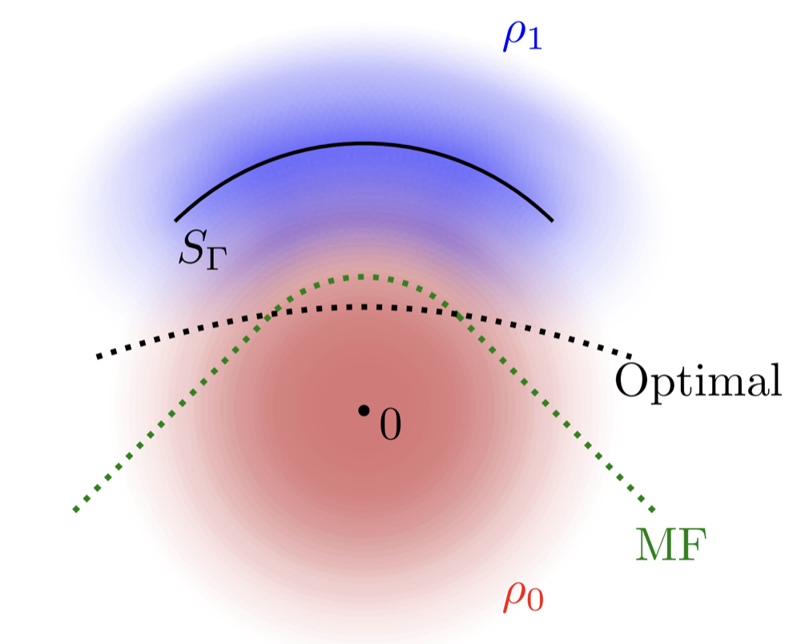

[Generalized approach to matched filtering using neural networks](https://arxiv.org/abs/2104.03961)
 Jingkai Yan, **Mariam Avagyan**, Robert E Colgan, Doğa Veske, Imre Bartos, John Wright, Zsuzsa Márka, Szabolcs Márka
 Physical Review D 105 (4), 043006. February 2022.

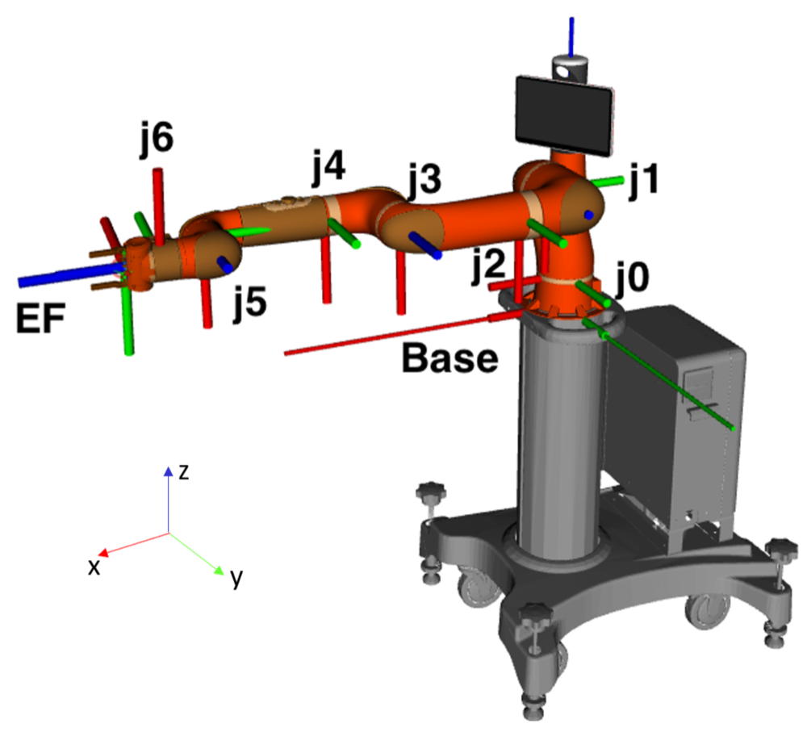

[VR-Mediated Teleoperation With Glove-Like Interfaces](https://asmedigitalcollection.asme.org/IMECE/proceedings/IMECE2018/52019/V002T02A095/276375)
 Kun Chen, Prawesh Dahal, **Mariam Avagyan**, Kevin Huang
 Proceedings of the ASME 2018 International Mechanical Engineering Congress and Exposition. Volume 2: Advanced Manufacturing. November 2018.

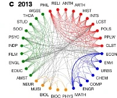

[Evolving network structure of academic institutions](https://link.springer.com/article/10.1007/s41109-016-0020-1)
 Shufan Wang, **Mariam Avagyan**, Per Sebastian Skardal
 Applied Network Science 2, 1 (2017). https://doi.org/10.1007/s41109-016-0020-1

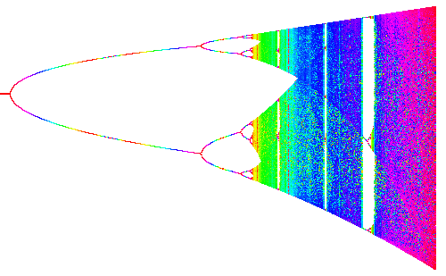

[Characterizing chaotic behavior of REM sleep EEG using Lyapunov exponent](https://ieeexplore.ieee.org/abstract/document/8302215)
 Prawesh Dahal, **Mariam Avagyan**, Per Sebastian Skardal, Harry J Blaise, Taikang Ning
 10th International Congress on Image and Signal Processing, BioMedical Engineering and Informatics (CISP-BMEI), October 2017.

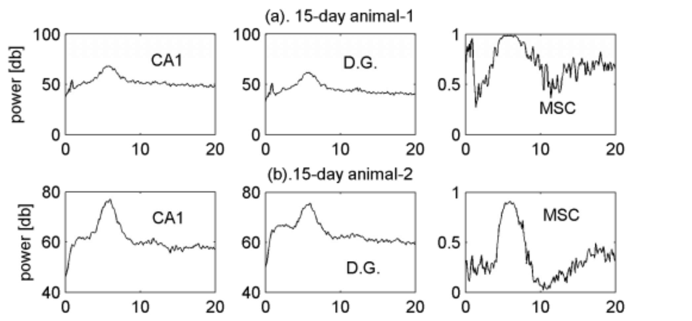

[Developmental differences of dimension complexity of hippocampal EEG during REM sleep](https://ieeexplore.ieee.org/abstract/document/7591324)
 Taikang Ning, J Harry Blaise, **Mariam Avagyan**, Prawesh Dahal
 38th International Conference of the IEEE Engineering in Medicine and Biology Society (EMBC), August 2016.

